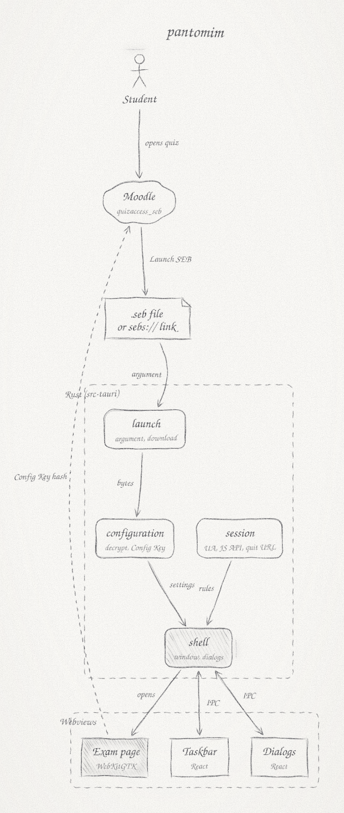
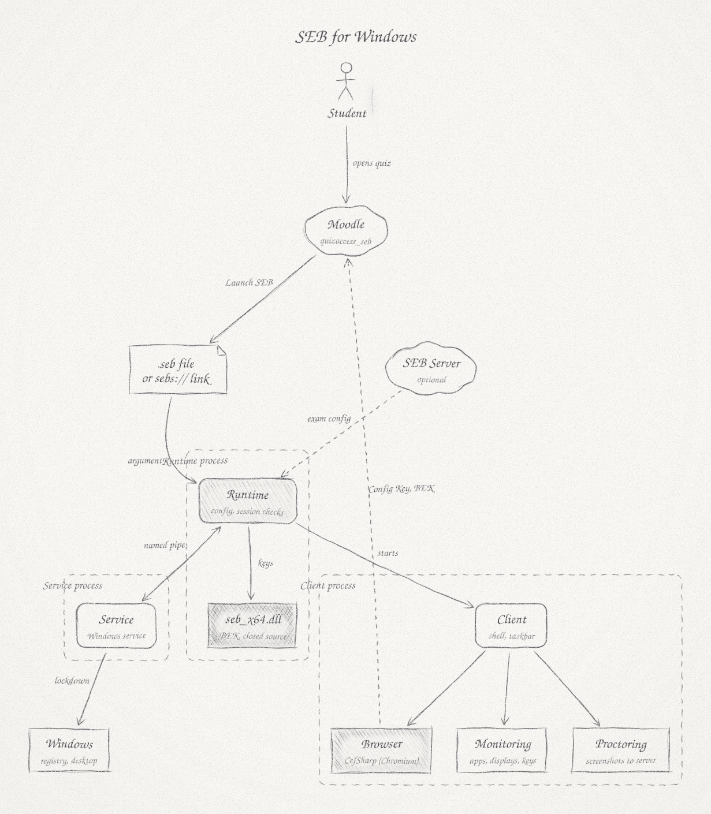

# Architecture

pantomim is a Tauri app. The Rust side reads the configuration and decides what to open; the windows are WebKitGTK webviews, one showing the exam and the others showing a small React UI.

## How a quiz opens

pantomim always starts with one argument, as SEB does. `open()` in `src-tauri/src/lib.rs` turns it into a `Start`:

- `Exam`: the configuration loaded and has a start URL.
- `Locked`: the `.seb` is password-protected. pantomim asks for the exam password, then tries again.
- `Failed`: the file is missing or broken, or the download failed. pantomim shows SEB's error message and exits.
- `NoArgument`: pantomim was started on its own and says how to open it.

A `sebs://` link is downloaded over `https://` first. When Moodle answers with a web page instead of a file (usually its login page), pantomim opens that page in the browser. The `.seb` then arrives as a download from inside the page and replaces the session, so the login is kept.

## Where the code lives

`src-tauri/src/configuration` reads `.seb` files: gzip, plain and password-encrypted containers, and the plist inside. It also computes the Config Key, which is the SHA-256 of SEB's own JSON serialization of the settings, quirks included. See [docs/spec/configuration.md](docs/spec/configuration.md).

`src-tauri/src/launch` handles the argument: `seb(s)://` links, deciding whether a download is a configuration or a web page, adding the link's query to the start URL, and picking the error message. See [docs/spec/launch.md](docs/spec/launch.md).

`src-tauri/src/session` covers what the exam server sees and the session rules: the user agent, the `window.SafeExamBrowser` script that goes into every frame (`api.js`), the quit URL and quit password, fullscreen and the window title. See [docs/spec/session.md](docs/spec/session.md).

`src-tauri/src/shell` is the Tauri glue. It builds the exam window, which holds two child webviews (the exam page and the taskbar), and opens dialogs as separate windows (`shell/dialog.rs`).

`src/` is the React UI. The taskbar and `PasswordDialog` follow SEB's XAML. `MessageBox` copies the native Windows 10 message box, which SEB uses for its messages and which has no XAML. `text.ts` holds SEB's texts word for word. Rust opens each screen at `index.html#screen=…`.

## Copying SEB

[SEB for Windows](https://github.com/SafeExamBrowser/seb-win-refactoring) is the reference for every behavior. Moodle rejects small differences, so pantomim copies the C# code closely, quirks and all. Comments name the C# class or method a piece of code comes from.

Anything the exam server can observe has a spec in `docs/spec/` with test vectors. The expected values come from SEB or from Moodle, never from pantomim's own output. Texts come from `SafeExamBrowser.I18n/Data/{id,en}.xml` and layouts from `SafeExamBrowser.UserInterface.Desktop`.

## Linux quirks

On Linux, Tauri packs child webviews into a vertical `GtkBox` and ignores the bounds given to `add_child`. The taskbar keeps its 40 px through GTK (`pin_height` in `shell.rs`); the exam page takes the rest.

A fixed-size GTK window keeps Tauri's default 800×600 and ignores later resizes. Dialogs therefore clear the default size, and the page measures itself and sets its webview's size request (`fit`) before the window is shown.

Wayland gives an application no way to make a window modal for the compositor or to disable its close button. Yes/No message boxes refuse to close instead, and each window opens at most one dialog at a time.

WebKitGTK keeps cookies in a Netscape-style `cookies` file under `~/.local/share/io.github.dirgaydtm.pantomim/`. `scripts/sandbox_setup.py` writes one into a separate profile in `/tmp` to log in the Moodle Sandbox's demo student.

## Compared with SEB for Windows

  
  

SEB for Windows runs as three processes that talk over WCF named pipes. The Runtime reads the configuration, runs its session checks (version restrictions, virtual machines, remote sessions, displays), fetches the exam configuration from SEB Server when one is set up, switches to kiosk mode and starts the Client. The Service is a Windows service running as `LocalSystem`; during an exam it changes registry and service settings to lock Windows down, and it restores them afterwards. The Client shows the browser, an embedded Chromium through CefSharp, along with the taskbar. It also watches applications, displays and keyboard shortcuts, and uploads screenshots when SEB Server asks for screen proctoring. The Browser Exam Key comes from `seb_x64.dll`, which is not part of the open-source code.

pantomim keeps the part that Moodle checks and runs it in one process:

| | SEB for Windows | pantomim |
|---|---|---|
| Processes | Runtime, Client and Service, over named pipes | One Tauri process |
| Browser engine | Chromium (CefSharp), shipped with SEB | WebKitGTK from the Linux distribution |
| Configuration and Config Key | `SafeExamBrowser.Configuration` | `configuration`, with the same rules and test vectors |
| Browser Exam Key | `seb_x64.dll` | Not supported |
| Lockdown, kiosk mode, monitoring | Service, `Lockdown`, `Monitoring` | None |
| SEB Server and proctoring | `SafeExamBrowser.Server`, `Proctoring` | Not supported |
| Request headers | Sent with main-frame and same-host requests when `sendBrowserExamKey` is on | Not sent yet |
| UI | WPF (XAML) | React in webviews, laid out after the XAML |
| Size | About 109,000 lines; 192 MB installer | About 1,100 lines; 2.7 MB package |
