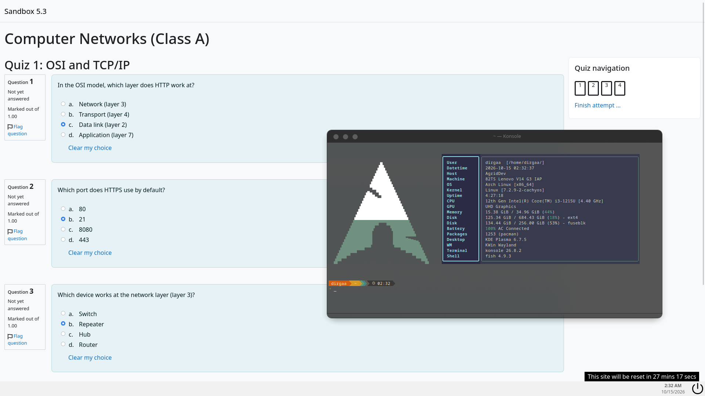

  <picture>
    <source srcset="docs/logo-dark.svg" media="(prefers-color-scheme: dark)">
    <source srcset="docs/logo.svg" media="(prefers-color-scheme: light)">
    
  </picture>

An SEB alternative for Linux. pantomim opens Moodle quizzes that require Safe Exam Browser (SEB), so you don't have to boot into Windows for them.

> pantomim is an unofficial project, not affiliated with or endorsed by ETH Zürich or the Safe Exam Browser project.
>
> It does not lock down your computer: there is no kiosk mode, and other applications keep running. Use it for real exams only with your institution's permission.

## What it does

Moodle checks for SEB through its `quizaccess_seb` plugin, and pantomim answers that check the way SEB for Windows does. It:

- reads `.seb` configuration files, including password-protected ones
- computes the Config Key and exposes `window.SafeExamBrowser` to every frame
- sends the SEB user agent
- opens `seb://` and `sebs://` links
- follows the configuration's quit URL, quit password and fullscreen settings
- shows a taskbar with a clock and a quit button, modelled on SEB's

## Limitations

Quizzes that require a Browser Exam Key (BEK) will refuse pantomim. The BEK comes from the signed official SEB build, and pantomim can't produce it.

The `X-SafeExamBrowser-*` request headers aren't sent yet. Moodle's default setup accepts the JavaScript check on its own.

pantomim has been tested on KDE Plasma (Wayland).

## Usage

Like SEB, pantomim always starts with one argument. Either click "Launch Safe Exam Browser" on the Moodle quiz page, or open a downloaded `.seb` file with pantomim. Started without an argument, it just tells you to do one of these.

## Contributing

[ARCHITECTURE.md](ARCHITECTURE.md) explains how pantomim is put together, and [CONTRIBUTING.md](CONTRIBUTING.md) covers building it, testing it against Moodle and copying SEB's behavior.

## Why "pantomim"?

Pantomim is Indonesian for pantomime. A mime acts out a wall that isn't there, and the audience sees it anyway. pantomim does the same with Safe Exam Browser: it copies the way SEB introduces itself and answers SEB's checks, so Moodle believes SEB is there.

## License

[Mozilla Public License 2.0](LICENSE). Parts of pantomim are translated from [Safe Exam Browser for Windows](https://github.com/SafeExamBrowser/seb-win-refactoring) (© ETH Zürich, IT Services, MPL 2.0); see [NOTICE](NOTICE).
